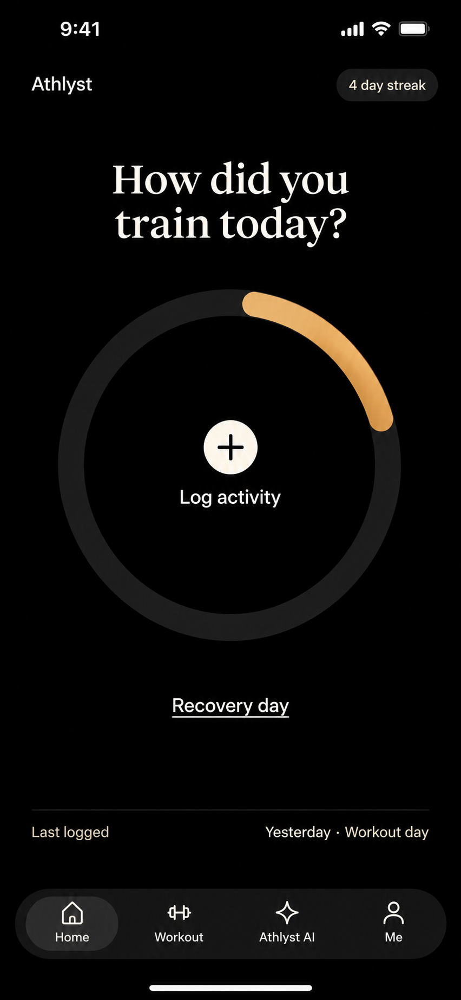
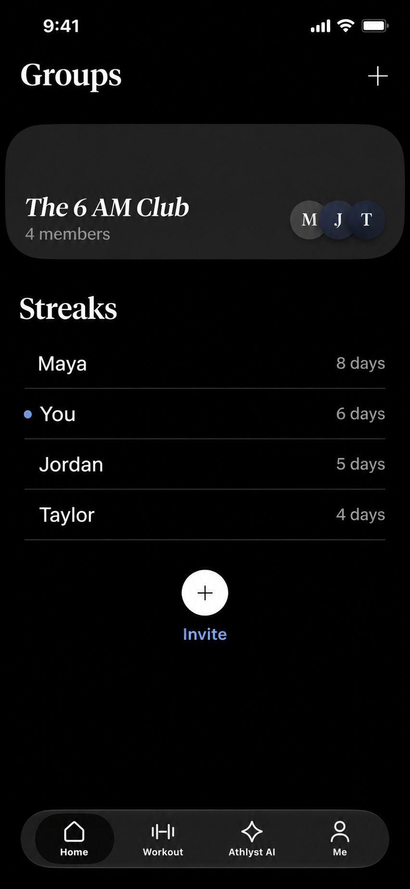
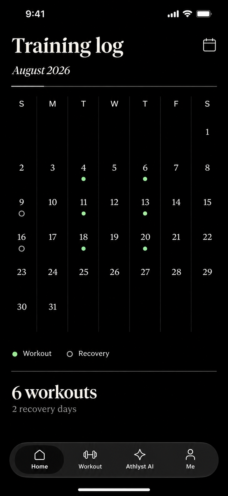

# Athlyst

Athlyst is a native iOS fitness app I founded and developed. It brings workout logging, personalized training plans, and progress tracking into one app.

I built the SwiftUI interface and designed the exercise and performance data models. I used Firebase for sign-in and cloud-synced workout history, and built AI-assisted recommendations around training goals, workout history, and progress.

**Stack** · Swift, SwiftUI, Firebase

## Design concepts

Three proposed screens for the next version of Athlyst.

  
  
  

